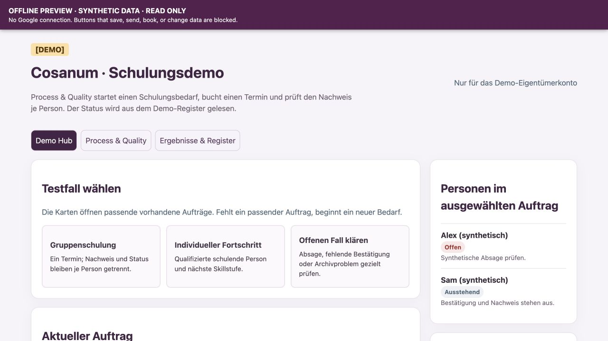

# Start developing

This path lets a contributor inspect the Demo Hub and check code from a clean checkout. It uses only fictional data and does not need Google authorization, credentials, or an `npm install` step. The connected demo is a separate acceptance environment.

## First 15 minutes

1. Install Git, Node.js 24, and Python 3.11 or newer. The repo's [`.node-version`](../.node-version) pins the Node major version; no third-party npm or Python packages are needed for the checks.
2. Clone `https://github.com/mattbang/cosanum-automation.git`, enter the checkout, and run `npm run check`. Expect 19 JavaScript test passes, an Apps Script syntax pass, an archive-helper test pass, and `All local checks passed.` The included workflow is configured to run the same command on pull requests on Linux, macOS, and Windows.
3. Run `npm run dev` and open `http://127.0.0.1:4173/`. The banner reads **OFFLINE PREVIEW · SYNTHETIC DATA · READ ONLY**. Open the Demo Hub, inspect a completed group and an open RSVP exception, then try a save or skill-update action. A visible blocked-action message is the expected result. Reloading resets the sample state.

The preview serves the checked-in Apps Script HTML with a synthetic adapter. It has no Google connection and cannot prove Form identity, Calendar booking, mail delivery, archive integrity, or a release deployment. Its [technical boundary](LOCAL_PREVIEW.md) explains the blocked routes and calls.

## Optional container or Codespaces

Open the repository in a tool that supports [dev containers](https://containers.dev/) or create a GitHub Codespace. The [container configuration](../.devcontainer/devcontainer.json) installs Node 24 and Python 3.13 and runs `npm run check` after creation. The pull-request workflow also builds this container and runs the same checks inside it. Start `npm run dev` in its terminal, then open the forwarded port 4173. Keep that port **private** to your account. The container sets `PREVIEW_HOST=0.0.0.0` so the forwarding service can reach the read-only preview; the ordinary local command listens only on `127.0.0.1`. A local Docker daemon is needed only if you choose the local container route.

## Common recovery steps

| Symptom | Action |
| --- | --- |
| Node version error | Use Node 24, then rerun `npm run check`. |
| Python version error | Install Python 3.11 or newer and rerun. `npm run check:js` runs the JavaScript subset while Python is unavailable. |
| Port 4173 is already in use | Stop the other preview or set a different `PORT` before `npm run dev` (`PORT=4180 npm run dev` in a Unix shell; `$env:PORT=4180; npm run dev` in PowerShell). |
| Preview looks stale | Reload the page. The server rereads `apps-script/Index.html` for each request. |
| A Google action says “blocked” | This is the intended read-only behavior. Use the named connected test process for Google verification. |

## From local change to accepted increment

Work on a focused branch and include the `npm run check` result in the pull request. Independent review and CI cover local behavior. For a Google integration, the handoff must name a verifier, the exact source commit and target environment, approved scopes, expected side effects, and a private run record. Only one person changes a shared Apps Script deployment or Sheet schema at a time. A local pass does not close a connected issue such as [Form identity #3](https://github.com/mattbang/cosanum-automation/issues/3).

The tracked [synthetic fixture](../fixtures/synthetic_demo.json) exists only for local tests. The ignored `data/demo_fixture.json`, OAuth files, test-account addresses, archive, and evidence stay private. Do not seed Google from the tracked fixture's `example.test` addresses. The [contributor setup issue #27](https://github.com/mattbang/cosanum-automation/issues/27) and [team sandbox issue #28](https://github.com/mattbang/cosanum-automation/issues/28) track the remaining development-environment acceptance.
