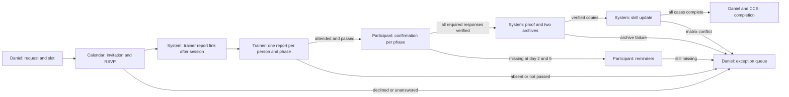

# Workflow assets for the training prototype

**Purpose:** Design inventory for increments 01–14. These are implementation templates and mockups for synthetic demo data, not live Google assets. The [specification](TRAINING_PROTOTYPE_SPECIFICATION.md) remains the authority for business rules. The [GUI design baseline](GUI_DESIGN_BASELINE.md) and its nine-screen Figma concept govern visual direction; the six-view local HTML mockup combines adjacent tasks to show fields, states, and actions. This inventory makes each user handoff and its required information explicit.

## End-to-end handoffs

| Step | Actor and surface | Information needed to act | Recorded outcome and next handoff | Asset |
| --- | --- | --- | --- | --- |
| 1. Create need | Daniel, admin web app | Topic/version, group or individual, participants, current and target skill, prerequisite result | Stable request and person-case IDs; invalid progression gives a reason and Sheet link | [Interface mockups](product/workflow_mockup.html), screens A–B |
| 2. Plan phases | Daniel, admin web app | Theory/practice requirements, qualified trainer, duration, order | Session IDs and phase plan; practice target remains gated by theory pass | [Interface mockups](product/workflow_mockup.html), screen B |
| 3. Propose and book | Daniel, admin web app; Calendar event to trainer and participants | All required free/busy results, Zurich start/end, phase, location if known | Rechecked slot, one event ID, invitees and RSVP state; conflict returns to proposals | [Interface mockups](product/workflow_mockup.html), screen C; [Calendar event template](product/CALENDAR_EVENT_TEMPLATE.md) |
| 4. Handle RSVP | Daniel, work queue | Guest response per person, session date, prior-business-day check | Decline or unanswered status on that person's case; group event continues; reschedule action stays explicit | [Case audit template](product/CASE_AUDIT_TEMPLATE.md); [interface mockups](product/workflow_mockup.html), screens A and C |
| 5. Assess training | System sends trainer link; assigned trainer uses verified-email Form | Session/phase, one participant, attendance, result, note | Trainer identity, response ID and time; only attended + passed advances | [Trainer email](NOTIFICATION_TEMPLATES.md); [trainer checklist template](product/TRAINER_CHECKLIST_TEMPLATE.md); [interface mockups](product/workflow_mockup.html), screen D |
| 6. Confirm participation | Assigned participant, verified-email Form | Their session details, affirmative checkbox, typed name, discrepancy route | Verified account, response ID and time; mismatches stay open | [Participant Form template](product/PARTICIPANT_FORM_TEMPLATE.md); [interface mockups](product/workflow_mockup.html), screen E |
| 7. Remind or escalate | Processor to participant; Daniel work queue | Original local training date, trainer pass, current acknowledgement state | Day +2/+5 mail ledger; after day +5, actionable exception | [Notification templates](NOTIFICATION_TEMPLATES.md); [interface mockups](product/workflow_mockup.html), screen A |
| 8. Generate proof | System, one Doc/PDF per person | Training source, trainer results and accepted participant responses for all required phases, IDs and timestamps | Versioned individual proof; pending archive | [Individual proof template](product/INDIVIDUAL_PROOF_TEMPLATE.md) |
| 9. Verify both archives | Local helper and Drive; Daniel status view | Drive PDF/Doc IDs, local PDF/DOCX paths, bytes and SHA-256 | Verified manifest or retryable pending/error; no skill update before verification | [Archive manifest template](product/ARCHIVE_MANIFEST.example.json); [interface mockups](product/workflow_mockup.html), screen F |
| 10. Update skill | System; Daniel sees result | Prior level, explicit target, valid prerequisite, verified proof and both archives | One change ID/time or conflict; level 4 never auto-awarded | [Case audit template](product/CASE_AUDIT_TEMPLATE.md); [interface mockups](product/workflow_mockup.html), screen F |
| 11. Resolve request | Processor to Daniel/CCS; Daniel audit view | Every selected person complete, or named open reasons | One request completion notice only when all complete; otherwise distinct exception and next action | [Notification templates](NOTIFICATION_TEMPLATES.md); [interface mockups](product/workflow_mockup.html), screens A and F |
| 12. Demonstrate | Demo operator | Six scenarios, test recipients, event/response/proof links, observed time and actions | Reproducible evidence and limitations for review | [Replay checklist](product/DEMO_REPLAY_CHECKLIST.md) |

## Shared record and interface rules

- Preserve `request_id`, `session_id`, `case_id`, `topic_id`, `person_key`, and `proof_version` across surfaces. A group may share a Calendar session but has a separate person case. Each required phase needs its own trainer response and participant acknowledgement; the person case has one final proof, archive receipt, and skill decision.
- Show a plain-language status and the next permitted action on each admin case. Keep **planned**, **invited**, **attended**, **passed**, **confirmed**, **archived**, and **skill applied** distinct. RSVP is not attendance; trainer pass is not participant confirmation; proof creation is not archive verification.
- Store machine timestamps in UTC or with offsets. Render training and reminder dates in `Europe/Zurich` with the zone visible on scheduling screens and Calendar events.
- Do not let a screen or Form override a failed evidence gate. A dashboard note, new link, archive retry, or replacement session is an action on an open case, not an administrative completion switch.
- Surface inaccessible Calendar data, wrong-account Form responses, failed archive verification, and changed matrix levels as explicit blocked states. Each needs a retry or review path and an audit entry.
- Make test data conspicuous with `[DEMO]`. No source workbook, real employee record, generated personal URL, credential, or individual evidence belongs in public templates.

## Source-of-truth boundaries

| Content | Canonical file | Implementation destination |
| --- | --- | --- |
| Visual direction and screen concepts | [GUI design baseline](GUI_DESIGN_BASELINE.md) and linked Figma file | Apps Script HTML Service layout and style |
| Screen fields, states, and actions | [HTML interface mockup](product/workflow_mockup.html) | Apps Script HTML Service, adapted to real state |
| Calendar event wording and fields | [Calendar event template](product/CALENDAR_EVENT_TEMPLATE.md) | Calendar event summary/description and API payload |
| Trainer questions and validation | [Trainer checklist template](product/TRAINER_CHECKLIST_TEMPLATE.md) | Verified-email Google Form and response processor |
| Participant questions and validation | [Participant Form template](product/PARTICIPANT_FORM_TEMPLATE.md) | Verified-email Google Form and response processor |
| Individual proof layout | [Proof template](product/INDIVIDUAL_PROOF_TEMPLATE.md) | Google Doc, PDF and local editable export |
| Archive metadata | [Manifest example](product/ARCHIVE_MANIFEST.example.json) | Local manifest plus register receipt |
| Admin search, actions, and change trail | [Case audit template](product/CASE_AUDIT_TEMPLATE.md) | Request/case dashboard and audit ledger |
| Email wording and delivery keys | [Notification contract](NOTIFICATION_TEMPLATES.md) and [Apps Script copy](../apps-script/NotificationTemplates.gs) | Future MailApp processor |
| End-to-end demonstration | [Replay checklist](product/DEMO_REPLAY_CHECKLIST.md) | Test run and handoff evidence |

These files are design inputs. Each increment must still pass its connected acceptance check before claiming that a Google interaction works.

## Platform references

The [Calendar event resource](https://developers.google.com/workspace/calendar/api/v3/reference/events/insert) supports summary, description, attendee email, start/end with zone, and guest updates. [Google Forms](https://developers.google.com/apps-script/reference/forms/form) exposes the published responder URL, while a [FormResponse](https://developers.google.com/apps-script/reference/forms/form-response) provides respondent email, response ID, and timestamp when collection is configured. Google [DocumentApp](https://developers.google.com/apps-script/reference/document/document-app) can create the editable proof. These API fields inform the templates; their behavior with the selected test accounts still needs integration checks.
